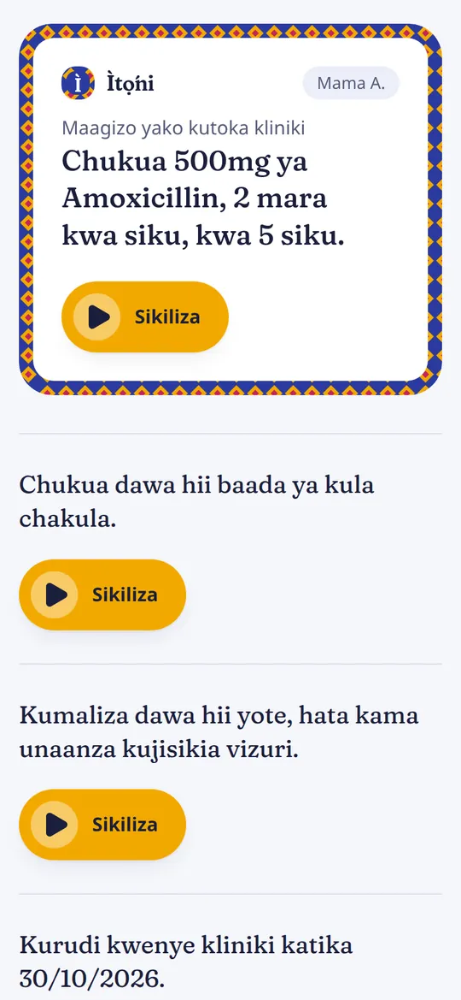

# Ìtọ́ni

Patient instructions in **Swahili**, as text and audio, handed over by QR code, with **Swahili voice replies** translated into English for clinic staff.

Built for the Build With NKENNEAi Hackathon (October 2026) with four NKENNEAi APIs. Swahili is the only language, by hackathon rule.

- **Live app:** https://itoni.vercel.app (press "See a patient's screen" for a public sample patient, no login)
- **API reference:** https://itoni.vercel.app/api/docs
- **Staff login for judges:** in the submission form

<p align="center">
  
</p>

## For judges: a 5-minute tour

1. **Patient side (no login).** Open https://itoni.vercel.app and press **See a patient's screen**. Play the Swahili audio, look at the digits box (dose, times a day, days and return date as digits), the red danger-signs box, and the consent box before recording. Try it on a phone: it is built for one.
2. **Staff side.** Log in at https://itoni.vercel.app/login with the details from the submission form.
   - **Dashboard**, then open **Mama A.**: English and Swahili side by side, audio, review badges, the QR code and the patient link.
   - **New instruction**: pick standard instructions, fill the values, create. Watch the phone preview fill in as you type.
   - **Inbox**: patients' voice notes. Replies sent during the hackathon show "Translation failed" with the recording kept, because NKENNEAi's speech services are down (see Known issues).
   - **Translations**: the Swahili review screen. **Usage**: every NKENNEAi call, cached or live.
3. **Under the hood.** The API reference at https://itoni.vercel.app/api/docs, the token report in [docs/TOKEN_USAGE.md](docs/TOKEN_USAGE.md), and the issues we found with NKENNEAi in [docs/NKENNEAI_API.md](docs/NKENNEAI_API.md), section 8.

To run it locally in mock mode (no key needed): see [Setup](#setup) below, about five minutes.

## Problem

In many East African clinics and pharmacies, instructions are written in English, while many patients are more comfortable in Swahili. Older patients and people with poor eyesight or limited formal education also struggle with small printed text. Patients leave unsure how to take their medicine, when to come back, or which danger signs need urgent care.

## Who it is for

- **Patients and caregivers** who understand Swahili better than English, including those who find reading hard.
- **Nurses, pharmacists and front-desk staff** who need to give clear instructions quickly without acting as translators.

## How it works

1. Staff pick standard instructions (dose and duration, take after food, finish the course, no alcohol, follow-up date, danger signs) and fill in the values.
2. Ìtọ́ni produces the Swahili text and audio and a QR code. Sentences it has seen before come from the cache.
3. The patient scans the QR code and reads or listens on their own phone. No app, no account. Dose, times a day, days and the return date are always shown as digits too, so a mistranslated number is still visible.
4. The patient can tick a consent box and send a Swahili voice note. Staff read it in English in the inbox and follow up in person. Ìtọ́ni never replies to patients by itself.

## Features

- Swahili instruction templates with a human review screen (edit, approve, undo)
- Spoken Swahili audio for every instruction, compressed for mobile data
- QR code and link handover; links expire after 30 days and can be revoked at once
- Voice replies (in-browser recording or audio upload) translated to English
- Staff inbox: conversations per patient, original audio, resolve with undo
- Placeholder and number validation so doses are never silently changed
- Usage screen and CSV export of every NKENNEAi call (live, cached, mocked, errors)
- Light and dark themes, phone to desktop layouts, keyboard and screen-reader support
- Public, read-only API reference at `/api/docs`

## NKENNEAi integration

| API | Endpoint | Role in Ìtọ́ni |
|---|---|---|
| Text-to-Text | `POST /api/translate/with-api-key` | English to Swahili: translates each template and interface label once, then cached. Also Swahili to English in the reply fallback |
| Text-to-Speech | `POST /api/tts/v1/swahili/with-api-key` | Swahili audio for each sentence (voice `asha`), cached by content, stored as MP3 |
| Speech Translation | `POST /api/st/v1/swahili-to-english/with-api-key` | A patient's Swahili voice reply to English in one call |
| Speech-to-Text | `POST /api/stt/v1/swahili/with-api-key` | Fallback: if Speech Translation fails on NKENNEAi's side, transcribe, then translate with Text-to-Text |

All calls go through one client, `backend/instructions/services/nkenne.py`: timeouts, retries only on gateway errors (502, 503, 504) and network failures, typed errors shown to staff, and one log row per call. Error bodies are never stored raw. Details and measurements: [docs/NKENNEAI_API.md](docs/NKENNEAI_API.md).

## Token usage and testing approach

- **Mock mode for development.** All development and the automated tests (134) run with `NKENNE_MOCK=true`: no network calls, no tokens.
- **Pay once per sentence.** Each template is translated once and each unique sentence gets audio once; re-running the seed commands costs nothing. Creating an instruction only calls the API for sentences never seen before (usually the dose and return-date lines).
- **One call per reply** with Speech Translation; the two-call fallback runs only when it fails.
- **No wasted retries.** A refused request (4xx) or a plain 500 is not retried.
- **Measured, not guessed.** Translation costs about 1 token per 4 characters of English (from `tokensRemaining`); seeding all 27 templates and the fixed-sentence audio took 31 calls.
- **The result:** the whole product was built and seeded on **592 of 1,050 tokens**, and on production **73% of requests are answered from the cache** (217 cache hits against 36 live calls). Every call is visible on the Usage screen and in the CSV.

Full numbers: [docs/TOKEN_USAGE.md](docs/TOKEN_USAGE.md).

**Mock mode disclosure.** When `NKENNE_MOCK=true`, responses are simulated and every screen shows a red, non-dismissable MOCK banner. The deployed app runs in live mode: no mocked responses are shown there.

## Known issues with NKENNEAi (reported)

Found while building, written up with evidence in [docs/NKENNEAI_API.md, section 8](docs/NKENNEAI_API.md):

1. **Speech services returning 500.** Since 23 Oct 2026, Speech Translation and Speech-to-Text have returned HTTP 500 for every request, including on NKENNEAi's own Text-to-Speech audio in the recommended WAV format, while Text-to-Text and Text-to-Speech work. Replies are therefore stored and playable for staff but marked "Translation failed". A 500 response also exposed internal request details; reported privately, and Ìtọ́ni never stores raw error bodies.
2. **Cloudflare blocks server-to-server calls.** From the production server on Render, every call gets Cloudflare's browser challenge (HTTP 403), so production cannot make live calls. Patient pages, audio and QR codes are unaffected (served from the cache); a new sentence goes out without audio, with a note for staff.

## Stack and third-party components

Monorepo. Backend: Django 5.2 JSON API (no DRF), PostgreSQL (SQLite locally), `imageio-ffmpeg` (bundled ffmpeg), `qrcode`, `requests`, WhiteNoise, gunicorn. Frontend: React 18, TypeScript, Vite, Tailwind CSS v4, React Router, `lucide-react`, Fraunces and Instrument Sans (Fontsource), browser MediaRecorder. API docs page: Scalar, loaded from a pinned CDN version with an integrity hash.

Hosting: frontend on Vercel, API and database on Render. Vercel proxies `/api`, `/admin` and `/static` to Render, so the app stays same-origin and session cookies work on iPhone Safari. A scheduled GitHub Action keeps the free Render instance awake.

No datasets. No pre-existing code from other projects. Landing page photo by [Speak Media Uganda](https://www.pexels.com/photo/nurse-caring-for-child-in-hospital-setting-34185202/) on Pexels (Pexels License); all illustrations and the kanga pattern are original.

## Setup

```bash
git clone https://github.com/dohoudaniel/itoni.git && cd itoni

# Backend (terminal 1)
cd backend
python3 -m venv venv && source venv/bin/activate
pip install -r requirements.txt
./scripts/setup_local_db.sh     # creates .env, the database, mock data, user nurse / itoni-demo-123
python manage.py runserver      # API on http://localhost:8000
python manage.py test           # always mock, no network

# Frontend (terminal 2)
cd frontend && npm install && npm run dev    # app on http://localhost:5173
```

Mock mode needs no API key. To use NKENNEAi for real, set `NKENNE_API_KEY` and `NKENNE_MOCK=false` in `backend/.env`, then run `python manage.py translate_templates --live` once.

More: phone testing over HTTPS and deployment in [docs/SETUP.md](docs/SETUP.md); production variables in [backend/.env.production.example](backend/.env.production.example).

## Try it

See [For judges: a 5-minute tour](#for-judges-a-5-minute-tour) at the top. Locally, the staff login is `nurse` / `itoni-demo-123`.

## Known limitations

- Templates use standard pharmacy wording but have **not been approved by a clinician**. Real use requires that.
- Translations are NKENNEAi machine output. The developer is not a Swahili speaker; each sentence is flagged "Unreviewed" until a fluent reader approves it in the Translations screen. _Update this line if and when a named reviewer has approved them._
- Voice replies depend on NKENNEAi's speech services, currently failing (see Known issues). Recordings are never lost; staff can always listen.
- Production cannot reach NKENNEAi until its Cloudflare rule allows server traffic; it runs on cached text and audio meanwhile.
- Swahili only, by hackathon rule. The language is stored as data, so adding others is small work once supported.
- Needs a smartphone with data. SMS and WhatsApp delivery are future work.
- Calls run synchronously (no task queue) to fit the free hosting tier; the service layer is ready to move behind a queue.
- Not a medical device and gives no medical advice.

## Future improvements

SMS and WhatsApp delivery, a clinician approval workflow for templates, more African languages, multi-clinic accounts, a background job queue.

## Documentation

[Architecture](docs/ARCHITECTURE.md) · [NKENNEAi API notes and known issues](docs/NKENNEAI_API.md) · [Templates](docs/TEMPLATES.md) · [Setup](docs/SETUP.md) · [Token usage](docs/TOKEN_USAGE.md) · [API reference](https://itoni.vercel.app/api/docs)

## License

MIT
