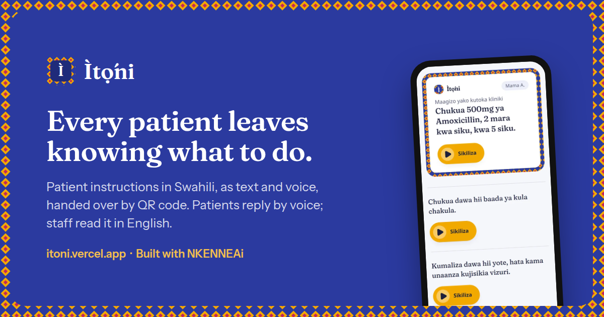
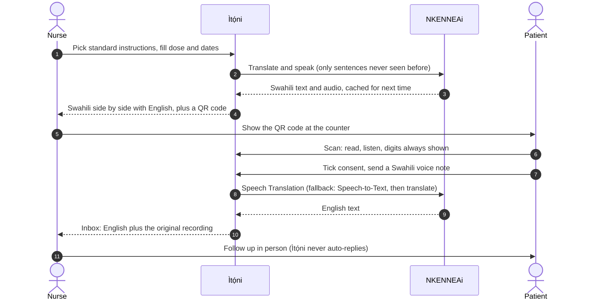
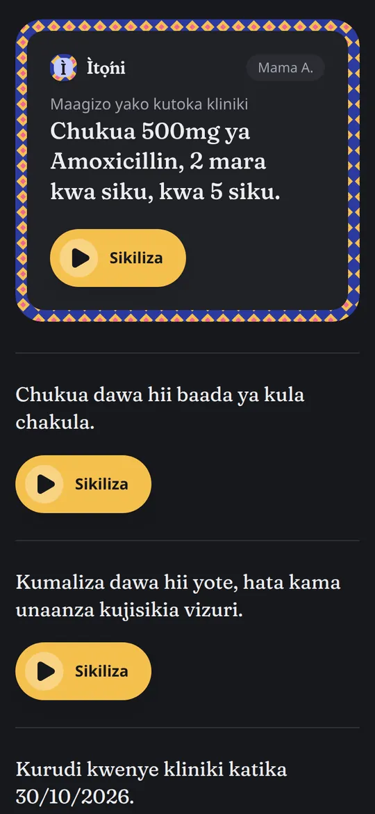
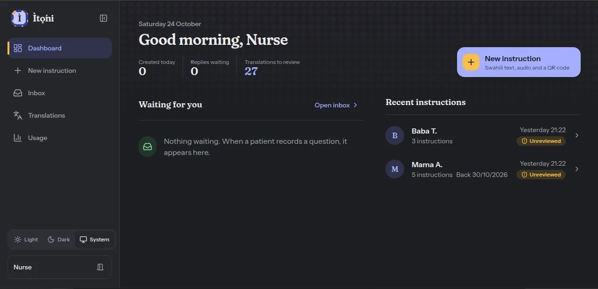
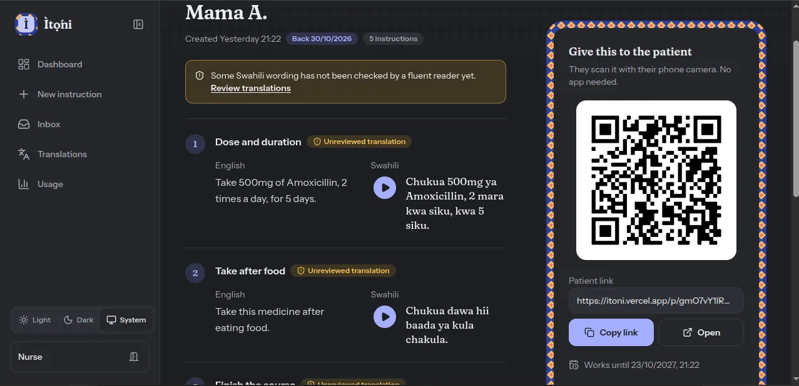
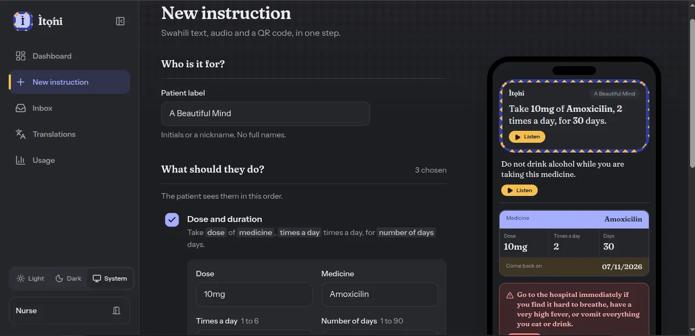
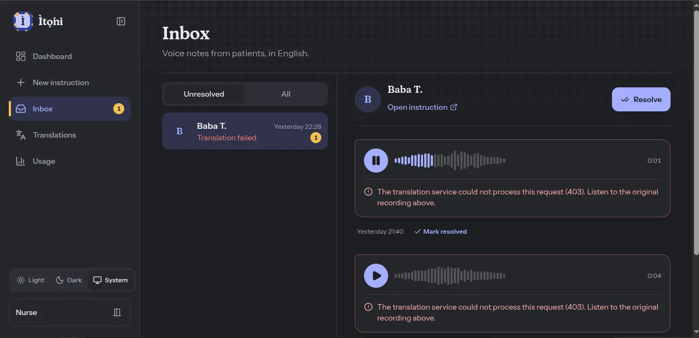
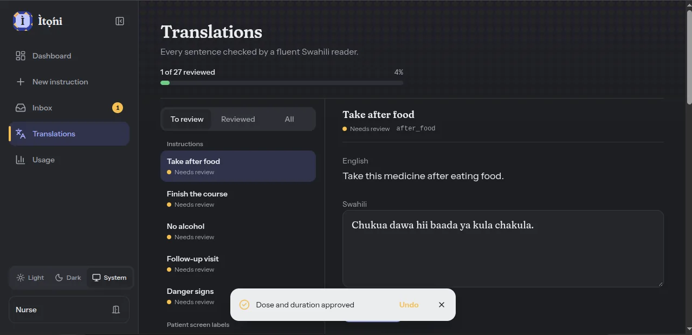
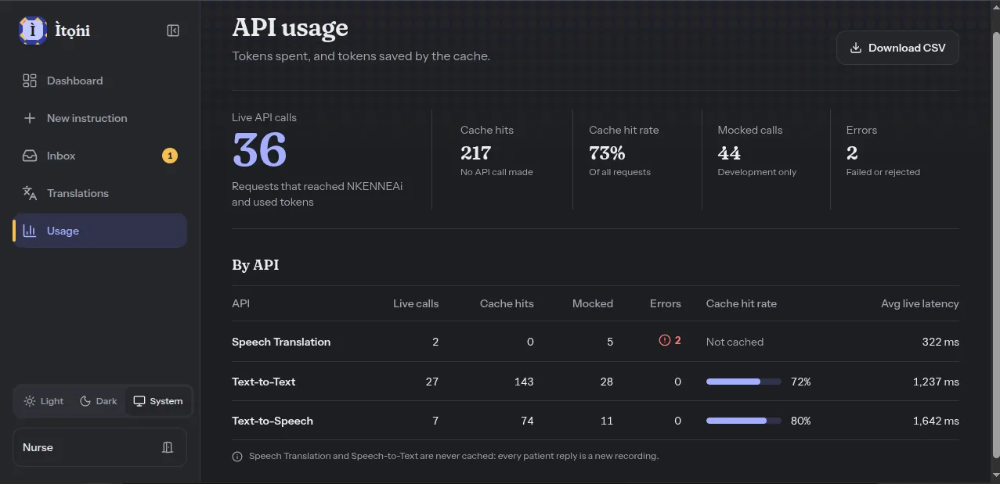
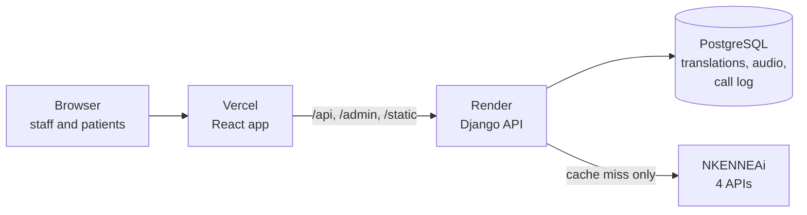

<p align="center">
  <a href="https://itoni.vercel.app">
    
  </a>
</p>

<h1 align="center">Ìtọ́ni</h1>

<p align="center">
  <strong>Patient instructions in Swahili, as text and voice, handed over by QR code.<br />Patients reply by voice; clinic staff read it in English.</strong>
</p>

<p align="center">
  <a href="https://itoni.vercel.app"></a>
  <a href="https://itoni.vercel.app"></a>
  <a href="https://itoni.vercel.app/api/docs"></a>
</p>

<p align="center">
  
  
  
  
  
  
  
  
</p>

<p align="center">
  Built for the <strong>Build With NKENNEAi Hackathon</strong> (October 2026). Swahili only, by hackathon rule.<br />
  <a href="#for-judges-a-5-minute-tour">Judges' tour</a> ·
  <a href="#how-it-works">How it works</a> ·
  <a href="#screens">Screens</a> ·
  <a href="#nkenneai-integration">NKENNEAi integration</a> ·
  <a href="#token-usage">Token usage</a> ·
  <a href="#setup">Setup</a> ·
  <a href="docs/ARCHITECTURE.md">Architecture</a>
</p>

---

## For judges: a 5-minute tour

> **Staff login for judges:** in the submission form. **Patient side:** no login needed.

1. **Patient side.** Open https://itoni.vercel.app and press **See a patient's screen**. Play the Swahili audio, look at the digits box (dose, times a day, days and return date as digits), the red danger-signs box, and the consent box before recording. Try it on a phone: it is built for one.
2. **Staff side.** Log in at https://itoni.vercel.app/login.
   - **Dashboard**, then open **Mama A.**: English and Swahili side by side, audio, review badges, the QR code and the patient link.
   - **New instruction**: pick standard instructions, fill the values, create. Watch the phone preview fill in as you type.
   - **Inbox**: patients' voice notes. Replies sent during NKENNEAi's speech outage show "Translation failed" with the recording kept ([known issues](#known-issues-with-nkenneai-reported)).
   - **Translations**: the Swahili review screen. Open an item, correct the Swahili if needed (each `{placeholder}` must stay exactly once), and press **Approve**; the next item opens by itself. Guide: [docs/TRANSLATIONS.md](docs/TRANSLATIONS.md).
   - **Usage**: every NKENNEAi call, cached or live.
3. **Under the hood.** The [API reference](https://itoni.vercel.app/api/docs), the [token report](docs/TOKEN_USAGE.md), and the [issues we found with NKENNEAi](docs/NKENNEAI_API.md).

Run it locally in mock mode, no key needed: [Setup](#setup), about five minutes.

## The problem

In many East African clinics and pharmacies, instructions are written in English, while many patients are more comfortable in Swahili. Older patients and people with poor eyesight or limited formal education also struggle with small printed text. Patients leave unsure how to take their medicine, when to come back, or which danger signs need urgent care.

**Who it is for:**
- **Patients and caregivers** who understand Swahili better than English, including those who find reading hard.
- **Nurses, pharmacists and front-desk staff** who need to give clear instructions quickly without acting as translators.

## How it works



## Screens

<div align="center">

**Patient screen** (no login, opened from the QR code)

<table>
  <tr>
    <td align="center"><br /><sub>Light</sub></td>
    <td align="center"><br /><sub>Dark</sub></td>
  </tr>
</table>

**Staff app**

<table>
  <tr>
    <td align="center"><br /><sub>Dashboard</sub></td>
    <td align="center"><br /><sub>Instruction with QR handover</sub></td>
  </tr>
  <tr>
    <td align="center"><br /><sub>New instruction, with live patient preview</sub></td>
    <td align="center"><br /><sub>Inbox (replies from the outage, recordings kept)</sub></td>
  </tr>
  <tr>
    <td align="center"><br /><sub>Swahili review</sub></td>
    <td align="center"><br /><sub>API usage and cache hits</sub></td>
  </tr>
</table>

</div>

## Features

| For patients | For staff | Safety and reliability |
|---|---|---|
| Swahili text and spoken audio for every instruction, small enough for mobile data | Pick standard instructions, fill values, get Swahili and a QR code | Doses and dates always shown as digits, so a mistranslated number is visible |
| No app, no account: scan and read | English and Swahili side by side, with review badges | Placeholder validation: a translation can never silently change a dose |
| Voice replies, consent first, recording or upload | Inbox per patient with the original audio; resolve with undo | Links expire after 30 days and can be revoked at once |
| Large tap targets, light and dark themes | A review screen where a fluent reader can approve each sentence | Recordings are never lost, even when translation fails |
| Every patient-screen word in Swahili | A usage screen and CSV of every API call | Never replies to patients automatically |

## NKENNEAi integration

| API | Endpoint | Role in Ìtọ́ni |
|---|---|---|
| Text-to-Text | `POST /api/translate/with-api-key` | English to Swahili: each template and interface label once, then cached. Also Swahili to English in the reply fallback |
| Text-to-Speech | `POST /api/tts/v1/swahili/with-api-key` | Swahili audio for each sentence (voice `asha`), cached by content, stored as MP3 |
| Speech-to-Text | `POST /api/stt/v1/swahili/with-api-key` | Transcribes a patient's Swahili voice reply; Text-to-Text then turns it into English for staff |
| Speech Translation | `POST /api/st/v1/swahili-to-english/with-api-key` | Integrated as an optional route (`NKENNE_REPLY_ROUTE=st`), off by default. NKENNEAi confirmed (24 Oct) it returns translated **speech**, not text, so staff need Speech-to-Text plus Text-to-Text to read a reply |



All calls go through one client, `backend/instructions/services/nkenne.py`: timeouts, retries only on gateway errors (502, 503, 504) and network failures, typed errors shown to staff, and one log row per call. Error bodies are never stored raw. Details and measurements: [docs/NKENNEAI_API.md](docs/NKENNEAI_API.md).

## Token usage

The whole product was built and seeded on **592 of 1,050 tokens**, and on production **73% of requests are answered from the cache** (217 cache hits against 36 live calls).

- **Mock mode for development.** All development and the 134 automated tests run with `NKENNE_MOCK=true`: no network calls, no tokens.
- **Pay once per sentence.** Each template is translated once and each unique sentence gets audio once. Creating an instruction only calls the API for sentences never seen before (usually the dose and return-date lines).
- **The cheapest working route for replies.** Speech-to-Text then Text-to-Text (about 27 tokens). Speech Translation returns translated audio by design, so it cannot give staff text; calling it would waste about 20 tokens per reply.
- **No wasted retries.** A refused request (4xx) or a plain 500 is not retried.
- **Measured, not guessed.** Translation costs about 1 token per 4 characters of English (from `tokensRemaining`); seeding all 27 templates and the fixed-sentence audio took 31 calls.

Full numbers: [docs/TOKEN_USAGE.md](docs/TOKEN_USAGE.md).

**Mock mode disclosure.** When `NKENNE_MOCK=true`, responses are simulated and every screen shows a red, non-dismissable MOCK banner. The deployed app runs in live mode: no mocked responses are shown there.

## Known issues with NKENNEAi (reported)

Both found while building, reported to NKENNEAi with evidence, and written up in [docs/NKENNEAI_API.md](docs/NKENNEAI_API.md), section 8.

<details>
<summary><strong>1. Speech services outage</strong>: down from 23 Oct, recovered on 24 Oct after we reported it</summary>

<br />

From 23 Oct every request failed: first with HTTP 500, then 504 and 503 "no healthy upstream", even on NKENNEAi's own Text-to-Speech audio in the recommended WAV format. Replies sent then are stored and playable for staff, marked "Translation failed". After we reported it, the services came back on 24 Oct (08:09 WAT): Speech-to-Text works again, and the full reply loop (a Swahili voice note arriving as English text in the staff inbox) was confirmed from a laptop the same morning. NKENNEAi also clarified that Speech Translation returns translated audio rather than the text shown in its PDF docs, so replies use Speech-to-Text plus Text-to-Text, the route that gives staff English text. A 500 response also exposed internal request details; reported privately, and Ìtọ́ni never stores raw error bodies.
</details>

<details>
<summary><strong>2. Server-to-server calls are blocked by NKENNEAi's bot protection</strong>: production runs on its cache</summary>

<br />

From the production server on Render, every call gets Cloudflare's browser challenge (HTTP 403, "Just a moment..."). NKENNEAi confirmed on 24 Oct that this is deliberate: its servers block requests that look automated, which includes calls from cloud servers. So the deployed app cannot make live calls. Patient pages, audio and QR codes are unaffected (served from the cache); a new sentence goes out without audio, with a note for staff, and replies are stored for staff to hear. Every live call in this project was made from a laptop.
</details>

## Setup

```bash
git clone https://github.com/dohoudaniel/itoni.git && cd itoni

# Backend (terminal 1)
cd backend
python3 -m venv venv && source venv/bin/activate
pip install -r requirements.txt
./scripts/setup_local_db.sh     # creates .env, the database, mock data, user nurse / itoni-demo-123
python manage.py runserver      # API on http://localhost:8000
python manage.py test           # always mock, no network

# Frontend (terminal 2)
cd frontend && npm install && npm run dev    # app on http://localhost:5173
```

Open http://localhost:5173 and log in as `nurse` / `itoni-demo-123` (local only). Mock mode needs no API key.

<details>
<summary><strong>Using the real API, phone testing and deployment</strong></summary>

<br />

- **Real API:** set `NKENNE_API_KEY` in `backend/.env`, run `python manage.py translate_templates --live` once, then set `NKENNE_MOCK=false`.
- **Phone testing** over HTTPS, **deployment** (Vercel and Render) and **troubleshooting:** [docs/SETUP.md](docs/SETUP.md).
- **Production variables:** [backend/.env.production.example](backend/.env.production.example).
- **Reviewing and adding translations:** [docs/TRANSLATIONS.md](docs/TRANSLATIONS.md).
</details>

<details>
<summary><strong>Stack and third-party components</strong></summary>

<br />

Monorepo. Backend: Django 5.2 JSON API (no DRF), PostgreSQL (SQLite locally), `imageio-ffmpeg` (bundled ffmpeg), `qrcode`, `requests`, WhiteNoise, gunicorn. Frontend: React 18, TypeScript, Vite, Tailwind CSS v4, React Router, `lucide-react`, Fraunces and Instrument Sans (Fontsource), browser MediaRecorder. API docs page: Scalar, loaded from a pinned CDN version with an integrity hash.

Hosting: frontend on Vercel, API and database on Render. Vercel proxies `/api`, `/admin` and `/static` to Render, so the app stays same-origin and session cookies work on iPhone Safari. A scheduled GitHub Action keeps the free Render instance awake.

No datasets. No pre-existing code from other projects. Landing page photo by [Speak Media Uganda](https://www.pexels.com/photo/nurse-caring-for-child-in-hospital-setting-34185202/) on Pexels (Pexels License); all illustrations and the kanga pattern are original.

**How it was built.** Daniel Dohou designed and led the project: he defined the problem and scope, made every product, design and architecture decision, ran every live NKENNEAi call, tested on real devices, deployed it, and reviewed and committed each change. Most of the code and documentation were written with an AI coding assistant (Claude Code) working under his direction.
</details>

<details>
<summary><strong>Known limitations</strong></summary>

<br />

- Templates use standard pharmacy wording but have **not been approved by a clinician**. Real use requires that.
- Translations are NKENNEAi machine output. The developer is not a Swahili speaker; each sentence is flagged "Unreviewed" until a fluent reader approves it in the Translations screen.
- Voice replies depend on NKENNEAi's speech services, which were down until 24 Oct (see Known issues). Recordings are never lost; staff can always listen.
- Production cannot call NKENNEAi: its bot protection blocks requests from servers by design (confirmed 24 Oct). The deployed app runs on cached text and audio; live calls work from a laptop or another non-data-centre connection.
- Swahili only, by hackathon rule. The language is stored as data, so adding others is small work once supported.
- Needs a smartphone with data. SMS and WhatsApp delivery are future work.
- Calls run synchronously (no task queue) to fit the free hosting tier; the service layer is ready to move behind a queue.
- Not a medical device and gives no medical advice.
</details>

## Future improvements

SMS and WhatsApp delivery, a clinician approval workflow for templates, more African languages, multi-clinic accounts, a background job queue.

## Documentation

| Doc | What it covers |
|---|---|
| [Setup](docs/SETUP.md) | Run locally, real API, phone testing, deployment, troubleshooting |
| [Architecture](docs/ARCHITECTURE.md) | How it is built, data model, API, security, tests |
| [NKENNEAi API notes](docs/NKENNEAI_API.md) | Endpoints, measured results, the two known issues |
| [Templates](docs/TEMPLATES.md) | Every sentence and label, value rules, reviewer checklist |
| [Translations](docs/TRANSLATIONS.md) | Reviewing in the app, adding a new sentence |
| [Token usage](docs/TOKEN_USAGE.md) | Where every token went, cache effectiveness |
| [API reference](https://itoni.vercel.app/api/docs) | Live, interactive OpenAPI reference (read-only) |

## License

MIT
