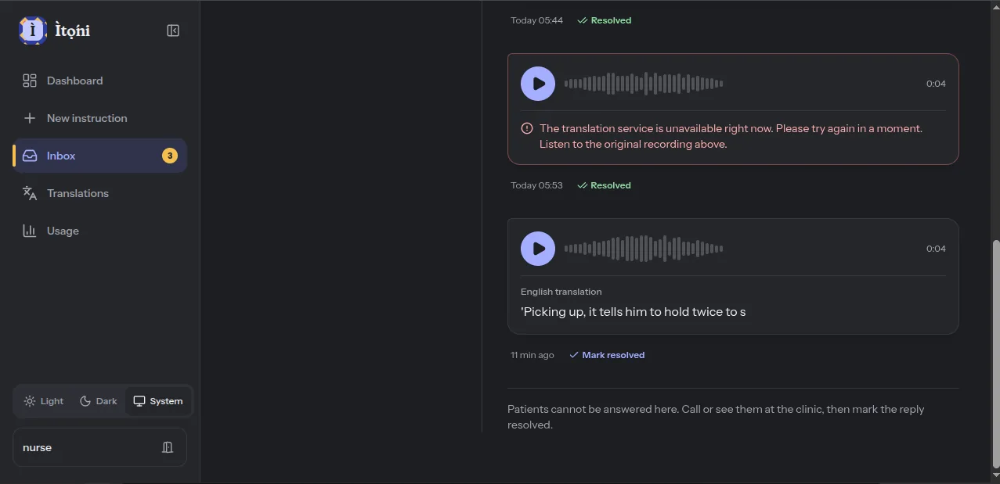

# NKENNEAi API: Integration Notes

Source: the four API documentation PDFs sent to finalists on 21 October 2026 (Text-to-Text, Text-to-Speech, Speech-to-Text, Speech Translation), which match https://nkenne.ai/nkenneai-api.

> **Hackathon rule:** Swahili is the only supported language for this event. The docs list Yoruba and Nigerian Pidgin too; do not use them. Every call in Ìtọ́ni is English ↔ Swahili.

- **Base URL:** `https://developers-api.nkenne.ai`
- **Auth header:** `Authorization: YOUR_API_KEY` (raw key, no "Bearer")
- **Get a key:** dashboard → Developer Tools → API Keys
- **Hackathon tokens:** 1,000 initial from the organizers, more in batches of 1,000 on approved request. Cost per call is not documented; it is measured in section 7.

---

## 1. Text-to-Text translation

`POST /api/translate/with-api-key` · `Content-Type: application/json`

```json
{ "text": "Take this medicine after food.", "fromLanguage": "English", "toLanguage": "Swahili" }
```
Response 200 (live, measured 23 Oct 2026):
```json
{ "translated_text": "Chukua dawa hii baada ya kula chakula.", "tokensRemaining": 1040, "message": "Translation completed using your API key" }
```
The PDF docs show `translatedText` (camelCase); the live API returns `translated_text`. `nkenne.translate()` accepts both. `tokensRemaining` is the account balance after the call.

Language strings are exact: `"English"`, `"Swahili"`. One side must be English.

| Code | Body | Meaning |
|---|---|---|
| 401 | `{"error": "Unauthorized"}` | Missing or bad key |
| 400 | `{"error": "Invalid language combination"}` | Pair not allowed |
| 400 | `{"error": "text, fromLanguage and toLanguage are required"}` | Missing field |

## 2. Text-to-Speech

`POST /api/tts/v1/swahili/with-api-key` · `Content-Type: application/json`

```json
{ "text": "...", "voice_name": "<id from voices endpoint>", "speaking_rate": 1.0 }
```
`voice_name` and `speaking_rate` (0.5 to 2.0) are optional. Consider `0.9` for older patients.

Response 200: binary audio (`audio/mpeg` or `audio/wav`). Save `response.content`.

Voices: `GET /api/tts/v1/swahili/voices` → `{ "language", "default_voice", "voices": [{id, name, gender}] }`. Call once, store the ID in `NKENNE_VOICE_SWAHILI`.

Errors: 401 bad key, 400 empty text, 404 unknown language slug or voice.

## 3. Speech-to-Text (reply fallback)

`POST /api/stt/v1/swahili/with-api-key` · multipart field `audio_file` (max 25 MB).
Formats: WAV (16-bit PCM recommended), MP3, M4A/AAC, FLAC, OGG. **WebM is not listed.**
Response: `{ "text", "duration", "language" }`.

**Live response (24 Oct 2026):** `{"status": "success", "transcription": "...", "tokensUsed": 12, "tokensRemaining": 414}`. The field is `transcription`, not the documented `text`; Ìtọ́ni accepts both. A 3.7 s clip cost 12 tokens.

**How replies reach English (`replies._to_english`, setting `NKENNE_REPLY_ROUTE`):**

- **`stt` (default since 24 Oct 2026):** Speech-to-Text, then Text-to-Text (`fromLanguage: "Swahili"`, `toLanguage: "English"`). About 12 + 15 tokens per short reply.
- **`st`:** Speech Translation first (one call), falling back to the two steps above on a provider failure (a 5xx, or a malformed answer, which is reported as 502). A 4xx (bad key, Cloudflare block) does not trigger the fallback, because the second route would be refused too.

Why Speech-to-Text is the default: Speech Translation answers `200` with `audio/mpeg`, an MP3 of the translated speech, at about 20 tokens. NKENNEAi confirmed on 24 Oct 2026 that this is how it works (speech in, translated speech out; the PDF example shows JSON text). Staff need English **text**, so the right route is Speech-to-Text, then Text-to-Text; calling Speech Translation would spend tokens on audio Ìtọ́ni cannot show.

## 4. Speech Translation (patient replies)

`POST /api/st/v1/swahili-to-english/with-api-key` · multipart field `audio_file` (max 25 MB).

Response 200:
```json
{ "translated_text": "...", "source_language": "swahili", "target_language": "english" }
```
Both text translation and speech translation return `translated_text` (snake_case) in practice.

Errors: 401 bad key, 400 `Unsupported translation pair slug`, 413 file over 25 MB.

## 5. Language mapping in Ìtọ́ni

| `Language` value | Translate `toLanguage` | TTS slug | Reply ST pair |
|---|---|---|---|
| `swahili` | `"Swahili"` | `swahili` | `swahili-to-english` |

Keep this table in one dict in `backend/instructions/services/nkenne.py` so adding a language later is one line.

## 6. Audio conversion for replies

```bash
ffmpeg -y -i input.webm -vn -ac 1 -ar 16000 -c:a pcm_s16le output.wav
```
- 16 kHz mono 16-bit PCM WAV: the format the speech docs mark as recommended, and the one every Speech Translation example uploads. 60 s is about 1.9 MB (limit 25 MB).
- Changed from OGG/Opus on 23 Oct 2026, after repeated Speech Translation 500s, to remove the one difference from the documented examples.
- Only 502, 503 and 504 are retried. A plain 500 has meant a model-server failure, where an immediate retry only spends more tokens.
- Binary path: `imageio_ffmpeg.get_ffmpeg_exe()`; run with `subprocess.run([...], timeout=30, check=True)` on temp files, never through a shell string.

## 7. Measured results (23 Oct 2026, `scripts/nkenne_test.py`)

| Question | Result |
|---|---|
| Tokens per translate call | About 1 token per 4 characters of English: 53 chars cost 14, 69 cost 17, 123 cost 31. The response carries `tokensRemaining` |
| Tokens per TTS call (short sentence) | About 1 token per 2 Swahili characters (inferred from the balance; see [TOKEN_USAGE.md](TOKEN_USAGE.md)) |
| Tokens per ST call (~10 s audio) | Not measurable: every Speech Translation call has failed on NKENNEAi's side (section 8) |
| Do `{curly}` placeholders survive? | Yes, all four, exactly once each. Word order around them follows English (`{times_per_day} mara kwa siku`), so the reviewer should reorder to `mara {times_per_day} kwa siku` as in the digits sentence |
| Do `[[1]]` sentinels survive? | No. The model replaced the whole sentence with invented text. Removed from `SENTINEL_STYLES` |
| Are "500mg", "2", "5" preserved? | Yes: "Chukua 500mg ya Amoxicillin, mara 2 kwa siku, kwa siku 5." |
| How does Swahili TTS read "500mg"? | Sample saved as `backend/scripts/out/swahili_digits.wav` (git-ignored); the digits box shows the exact value regardless |
| Swahili voice IDs available | `asha` (default), `neema`, `baraka`, `juma` |
| Typical latency translate / TTS / ST | 1.3 to 1.8 s / 1.5 s / ST failed after 2.3 s |
| TTS output format | `audio/wav`, 16 kHz mono PCM, about 32 KB per second. Stored as 48 kbps MP3 (5x smaller) |

Wording found during the test: "cannot keep food or water down" came back as "huwezi kuweka chakula au maji chini" (literally "cannot put food or water on the ground"). An English idiom the model translated word for word.

The Speech Translation failure from this test is written up in section 8, issue 1.

---

## 8. Known issues found during the hackathon

Both were reported to the NKENNEAi team (Abdul Bari): issue 1 on 23 Oct 2026, issue 2 on 24 Oct 2026. Ìtọ́ni's workarounds are in the code and listed here so judges and future maintainers can verify them.

| # | Issue | Seen | Impact on Ìtọ́ni | Status |
|---|---|---|---|---|
| 1 | Speech Translation 500 errors expose internal request details | 23 Oct 2026, 15:21 GMT, from a laptop | One failed test call. No Ìtọ́ni secret was involved | Reported privately; Ìtọ́ni never stores raw error bodies |
| 2 | Cloudflare bot challenge blocks server-to-server calls from Render | 23 Oct 2026, from 21:40 WAT, every call from the production server | Production cannot make live calls: replies are not translated, new audio cannot be made | Reported 24 Oct 2026. NKENNEAi replied the same day that this is deliberate bot protection, not a fault |

### Issue 1: Speech Translation 500 echoes internal request details

**What happened.** `POST /api/st/v1/swahili-to-english/with-api-key` returned `500` with the reason "Speech translation failed" and an upstream detail of "CUDA out of memory": the model server ran out of GPU memory. That part is a capacity problem on NKENNEAi's side, not a bad request, and a later retry is the right response.

**It happened again** on 23 Oct 2026 at 22:40 WAT, from a laptop (so not the Cloudflare block in issue 2): three attempts at one reply each returned `500` "Speech translation failed | Request failed with status code 500". That reply was sent as OGG/Opus, which the speech docs list as supported; the very first failure was a WAV. Ìtọ́ni now sends the recommended 16-bit PCM WAV and no longer retries a plain 500 (see section 6), so a recurrence costs one call, not three. It failed once more on 24 Oct 2026 at 05:44 WAT with exactly the documented request (16-bit PCM WAV, one attempt), which rules out the audio format: the fault is on NKENNEAi's side. Replies now fall back to Speech-to-Text plus Text-to-Text (section 3).

**Speech-to-Text is down too.** On 24 Oct 2026 at 05:53 WAT the fallback ran as designed: Speech Translation returned `500` after 8.1 s, then Speech-to-Text returned `500` "Speech-to-Text transcription failed | Request failed with status code 500" after 3.1 s, so Text-to-Text was correctly not called. The audio was NKENNEAi's own Text-to-Speech output (`scripts/out/swahili_digits.wav`, 16 kHz mono 16-bit PCM, 118,828 bytes): clean Swahili in the recommended format, which rules out the input. Text-to-Text and Text-to-Speech kept working throughout. Each failed reply is stored with its original audio and marked "Translation failed" for staff, as designed.

| Time (WAT) | Endpoint | Audio | Attempts | Result |
|---|---|---|---|---|
| 23 Oct 16:21 | Speech Translation | WAV (smoke test) | 1 | 500, CUDA out of memory |
| 23 Oct 22:39 | Speech Translation | OGG/Opus | 3 (old retry rule) | 500 each |
| 24 Oct 05:44 | Speech Translation | WAV, 16-bit PCM | 1 | 500 |
| 24 Oct 05:53 | Speech Translation, then Speech-to-Text | WAV, 16-bit PCM | 1 each | 500, then 500 |
| 24 Oct 06:43 | Speech Translation, then Speech-to-Text (`backend/scripts/nkenne_speech_repro.py`, run at NKENNEAi's request) | WAV, 16-bit PCM | 1 each | 504 gateway time-out after 66 s, then 503 "no healthy upstream" |
| 24 Oct 08:09 | Same script, after NKENNEAi's engineers looked into it | WAV, 16-bit PCM | 1 each | **Recovered.** Speech-to-Text 200 with a Swahili transcript (12 tokens). Speech Translation 200 with `audio/mpeg`, translated speech, which NKENNEAi later confirmed is its intended output (about 20 tokens) |

**Full reply loop confirmed (24 Oct, about 08:39 WAT, from a laptop):** a Swahili voice note on a patient link went through Speech-to-Text and Text-to-Text and appeared in the staff inbox as English text. The English was rough ("Picking up, it tells him to hold twice to s"), because the test clip was a short synthetic sentence and the Swahili transcript itself was imperfect, but every step worked.



**Status (24 Oct, 08:09 WAT): recovered.** Speech-to-Text works again (its field is `transcription`, not the documented `text`). Speech Translation answers with translated speech (an MP3), which NKENNEAi confirmed is intended; staff need text, so replies go through Speech-to-Text and Text-to-Text (section 3). The NKENNEAi dashboard also shows that failed calls were charged 1 token each.

The last run is the clearest: "no healthy upstream" comes from NKENNEAi's load balancer and means no speech server instance was running behind the endpoint. The reproduction script prints a shareable report with the key never shown and token-like values redacted.

**The security part.** The JSON error body did not stop at a message. Under `details` it included the response and request of NKENNEAi's own internal call to its model server: internal request headers (including an authorization header for that upstream call), the server software, and a stack trace with internal file paths. This is NKENNEAi's credential, not the caller's API key, but anyone who triggers a 500 can read it. The specific values are deliberately not reproduced here.

**What we asked for.** Return only a short `message` and `error` to API callers, log the rest server-side, and rotate the exposed upstream credential.

**How Ìtọ́ni protects itself.** `nkenne._extract_error` never stores a raw error body. From JSON errors it keeps only the `message` and `error` strings; from non-JSON errors, a 120-character tag-free summary with anything token-like replaced by `[redacted]`. Nothing from an error body can reach `ApiCallLog`, the Usage screen or the CSV export. Tests: `test_error_log_never_stores_the_raw_body`, `test_non_json_error_is_summarised_safely`.

### Issue 2: Cloudflare challenges every call from the production server

**What happened.** From the Render web service (Oregon), every call to `developers-api.nkenne.ai` returns `403` in about 0.3 s with an HTML page from `server=cloudflare` titled "Just a moment...". That is Cloudflare's browser challenge, which expects JavaScript to run. A server cannot pass it, so the request never reaches NKENNEAi. The same key, endpoint and audio file work from a home connection, so the key, the request format and the account are fine.

Logged by Ìtọ́ni as: `HTTP 403 | text/html | server=cloudflare | Just a moment...`

**Why it matters.** An API meant for developers is called from servers, and servers run in data centres, whose addresses bot protection treats as suspicious. Any team deploying to Render, Railway, Fly.io or a cloud VM is likely to hit this.

**What we asked for.** Exempt the `/api/*/with-api-key` routes from the bot challenge (API traffic is authenticated by key already), or allow the outbound addresses of the hosting provider.

**How Ìtọ́ni degrades meanwhile.**

| Feature on production | Behaviour while blocked |
|---|---|
| Patient screen, audio, QR codes | Unaffected: served from the database cache, no API call |
| Creating an instruction | Still works. Text comes from the translation cache; a sentence whose audio cannot be made goes out without audio, staff see an "Audio unavailable" note, and the next use retries (`rendering._clip_or_none`) |
| A patient's voice reply | Stored and playable for staff, marked "Translation failed" instead of being lost |
| Translation of a never-seen template | Fails with a clear message; nothing half-created |

**Re-tested 24 Oct 2026, 07:27 UTC**, after the speech services recovered: a patient reply on production called Speech-to-Text and was still answered `403 | text/html | server=cloudflare | Just a moment...`, while the identical request from a laptop returned 200 twenty minutes earlier. Only the source address differs, so the block is on NKENNEAi's edge, not in the request.

**NKENNEAi's answer (24 Oct 2026):** the block is intended. NKENNEAi has added security that automatically blocks requests that look automated, and certain duplicate requests, to prevent bot use of the APIs. Server-to-server calls from a cloud host fall under that rule, so the deployed app is designed to run on its cache, and live calls are made from a non-data-centre connection. Ìtọ́ni does not try to work around the protection.

**How to verify.** Django admin → Api call logs → filter `Status code: 403`: each row shows the Cloudflare summary above, with a latency of about 300 ms.
